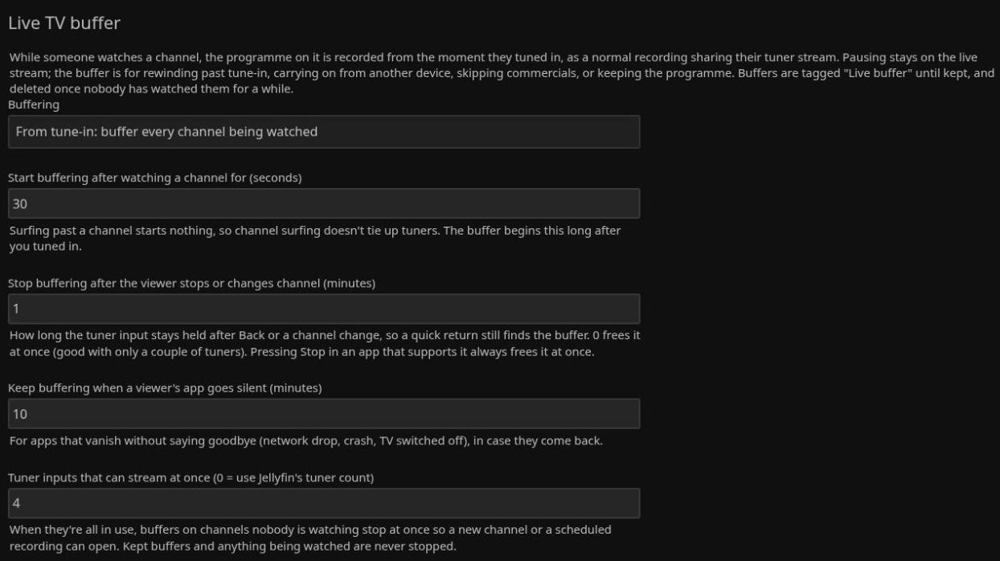

# JellyDVR Live (Jellyfin plugin)

A SageTV-style live TV buffer for Jellyfin 12. While someone watches a channel, the programme on it is
recorded from the moment they tuned in, as an ordinary Jellyfin recording that shares their tuner stream.
Pausing stays on the live stream as usual; the buffer is for:

- rewinding past the point where you tuned in,
- carrying on from another device (pause on the TV, resume on the laptop),
- skipping commercials while catching up (the Comskip plugin scans recordings in progress),
- keeping the programme as a real recording from the moment you tuned in.

Part of the JellyDVR set alongside Comskip Commercial Segments, Episode History, JellyDVR Space and XMLTV
Guide Cleaner.

## How it works

- Watches playback of live channels. For each channel being watched, the current programme is recorded by a
  one-off Live TV timer (no padding). Shortly before a programme ends, the next one's timer is set, so the
  buffer carries on across the boundary.
- If the programme is already being recorded by a scheduled timer, that recording is used as the buffer and
  never touched.
- Jellyfin's own schedule decides whether a buffer is recording: after a server restart Jellyfin resumes
  in-progress recordings into new files ("… - 1.ts"); the plugin picks those up, stops them by the usual rules,
  and tags and deletes every file a buffer produced.
- Buffering starts only once someone has stayed on a channel for a while (default 30 seconds), so channel
  surfing doesn't tie up tuners.
- Buffering stops a minute after the last viewer stops or changes channel, or 10 minutes after their app goes
  silent without saying so (both settings).
- Buffer recordings are tagged `Live buffer` until kept. Episode History ignores them and JellyDVR Space
  deletes them first when space runs low.
- **Keep** turns a buffer into an ordinary recording: untagged, recorded to the end of the programme, never
  deleted by this plugin.
- Buffers nobody kept are deleted once nobody has watched them for a while (default 4 hours), with their
  sidecars and any season/show folder they left empty.

The buffer list lives at `<data>/jellydvr-live/buffers.json` so the other JellyDVR plugins can read it.

## Settings (Dashboard → Plugins → JellyDVR Live)

- **Buffering** — *From tune-in* (default), *On demand* (only when a viewer asks), or *Off*.
- **Start buffering after watching a channel for** — seconds (default 30).
- **Stop buffering after the viewer stops or changes channel** — minutes (default 1).
- **Keep buffering when a viewer's app goes silent** — minutes (default 10).
- **Tuner inputs that can stream at once** — 0 (default) uses Jellyfin's tuner count. When all are in use (or a
  scheduled recording is about to start), buffers on channels nobody is watching stop at once, least recently
  watched first, so the next channel or recording can open.
- **Delete unkept buffers** — hours after they were last watched (default 4).

## API (for the web and TV client add-ons)

- `GET /JellyDvrLive/Channel/{channelId}` — buffers for a channel, oldest first.
- `POST /JellyDvrLive/Channel/{channelId}/Start` — start buffering now (on-demand mode).
- `GET /JellyDvrLive/Item/{itemId}` — the buffer an item belongs to, if any.
- `GET /JellyDvrLive/Programs` — guide programme ids that are only buffers (for a fainter recording mark).
- `POST` / `DELETE /JellyDvrLive/Keep/{bufferId}` — keep / un-keep.
- `GET /JellyDvrLive/Status` — everything (admin).

## Web player buttons

While a live channel plays in jellyfin-web, two buttons appear next to the player's Settings button:
**Buffer** (history icon) opens the buffer recording at the moment you're watching — then the normal
recording controls rewind past tune-in and skip commercials — and **Keep** (bookmark icon) keeps the
programme on now. While a buffer recording plays, only Keep shows. Pausing stays on the live stream.

## Screenshots

From a real server (Jellyfin 12.2). The web player on a live channel: **Keep** (bookmark) and **Buffer**
(history) beside the Settings button:


Settings (Dashboard → Plugins → JellyDVR Live):



## Install

### From the JellyDVR plugin repository (no build needed)

1. Dashboard → Plugins → **Repositories** → add (one list for all the JellyDVR plugins):
   ```
   https://raw.githubusercontent.com/mackandall/jdvr-client/main/plugins/manifest.json
   ```
2. Dashboard → Plugins → **Catalog** → **JellyDVR Live** → Install, then restart Jellyfin.

### Web player buttons (optional)

jellyfin-web has to load one script for this. Its `index.html` belongs to root, so it's a command run once
with sudo, and again after every jellyfin-web upgrade (which overwrites it):

```
curl -fsSLO https://raw.githubusercontent.com/mackandall/jellyfin-plugin-jellydvr-live/main/install-web.sh
sudo bash install-web.sh
```

### Or build from source

```
dotnet build -c Release
sudo ./install.sh       # restarts Jellyfin
sudo ./install-web.sh   # once, and after every jellyfin-web upgrade; then reload the browser tab
```

## License

GPL-2.0-or-later: you can redistribute and change it under the terms of the GNU General Public
License, version 2 or (at your option) any later version. See [LICENSE](LICENSE).

The official source and releases are at <https://github.com/mackandall/jellyfin-plugin-jellydvr-live>.
